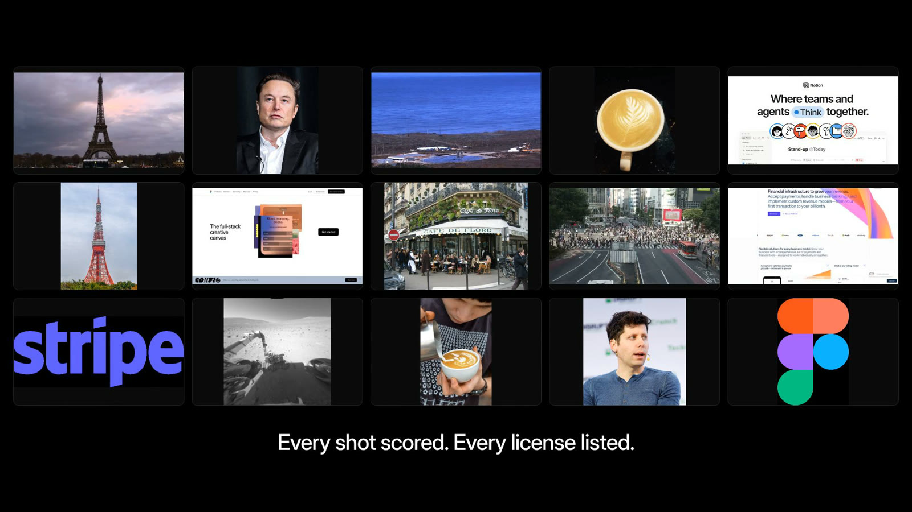

# Clypmint B-Roll



**B-roll for agents.** One call returns real photos and footage of exactly what your script says: the person, the company, the app, the place, the moment. Every shot is checked by a vision model, scored 0-10, and labelled with its license.

```bash
claude mcp add --transport http clypmint-broll https://clypmint.com/mcp/broll \
  --header "Authorization: Bearer $CLYPMINT_API_KEY"
```

Then ask your agent: *"find b-roll for every name in this script."*

[Get a key](https://clypmint.com/broll/dashboard) (100 free searches a month) · [Try it in the browser](https://clypmint.com/broll) · [Docs](https://clypmint.com/broll/docs)

---

## Why

AI video agents are good at scripts and voices. They are bad at pictures. They reach for stock ("a man at a laptop") or scrape image search and get watermarks, fan art and the wrong person.

Clypmint B-Roll gives the agent the shot an editor would pick:

| You ask for | You get |
|---|---|
| `Sam Altman` | Licensed portraits of Sam Altman, scored 9-10, with the credit line |
| `Notion` + "I plan every video in Notion" | The live notion.com interface, recorded on your machine, plus Notion's own share image |
| `booster` + "SpaceX just landed the booster again" | Public-domain footage of a Falcon 9 booster touchdown |
| `Eiffel Tower`, type video | Five 9/10 clips, including a vertical one |
| `answering phone` + "she spends half her day answering calls" | A real office photo of someone on a desk phone |

On 69 real subjects named in Clypmint customer edits, it found a shot scoring 7+/10 for **62%**, against **23%** for the web image search pipeline we used before. A search takes about 5 seconds.

## How it works

1. **Plan.** Send the subject and, ideally, the line it plays over. The line decides which "Claude" or "Apple" you mean.
2. **Find.** We look up what the name means (Wikidata), then search sources that publish for reuse: Wikimedia Commons, NASA, Internet Archive public-domain film, the subject's own website and its official YouTube channel.
3. **Check.** One vision call scores every candidate against what the shot must show. Wrong person, watermark, collage, book cover: dropped.
4. **Drop it in.** Each shot is a download URL, or one command that cuts the clip or records the live site on your machine.

## Use it

### MCP (Claude Code, Cursor, Codex, any MCP client)

Server: `https://clypmint.com/mcp/broll` · tools: `find_broll`, `plan_broll`, `broll_usage`

<details><summary>Cursor (<code>~/.cursor/mcp.json</code>)</summary>

```json
{
  "mcpServers": {
    "clypmint-broll": {
      "url": "https://clypmint.com/mcp/broll",
      "headers": { "Authorization": "Bearer cm_live_YOUR_KEY" }
    }
  }
}
```
</details>

<details><summary>Codex (<code>~/.codex/config.toml</code>)</summary>

```toml
[mcp_servers.clypmint-broll]
url = "https://clypmint.com/mcp/broll"
bearer_token_env_var = "CLYPMINT_API_KEY"
```
</details>

### REST

```bash
curl https://clypmint.com/api/v1/broll/search \
  -H "Authorization: Bearer $CLYPMINT_API_KEY" \
  -H "Content-Type: application/json" \
  -d '{"query": "Sam Altman", "context": "Sam Altman just walked on stage", "type": "image", "limit": 1}'
```

```json
{
  "request_id": "2b9d7f0e-6c1a-4f53-9d0e-6a1f3c8e2b41",
  "query": "Sam Altman",
  "interpreted": {
    "subject": "Sam Altman",
    "kind": "person",
    "entity": {
      "id": "Q7407093",
      "label": "Sam Altman",
      "description": "American entrepreneur and investor (born 1985)",
      "url": "https://www.wikidata.org/wiki/Q7407093"
    },
    "look_for": "Sam Altman walking onto a stage at a conference or event"
  },
  "verified": true,
  "results": [
    {
      "id": "commons:File:Sam Altman speaking at TED.jpg",
      "type": "image",
      "title": "Sam Altman speaking at TED",
      "shows": "Full shot of Sam Altman seated on stage at TED",
      "score": 9,
      "url": "https://upload.wikimedia.org/wikipedia/commons/0/06/Sam_Altman_speaking_at_TED.jpg",
      "thumbnail_url": "https://thumb.wikimedia.org/wikipedia/commons/thumb/0/06/Sam_Altman_speaking_at_TED.jpg/500px-Sam_Altman_speaking_at_TED.jpg",
      "width": 2184,
      "height": 2633,
      "orientation": "portrait",
      "duration_seconds": null,
      "source": {
        "name": "Wikimedia Commons",
        "page_url": "https://commons.wikimedia.org/wiki/File:Sam_Altman_speaking_at_TED.jpg"
      },
      "license": {
        "name": "CC BY 2.0",
        "url": "https://creativecommons.org/licenses/by/2.0",
        "commercial_use": true,
        "attribution": "Steve Jurvetson / CC BY 2.0 / https://commons.wikimedia.org/wiki/File:Sam_Altman_speaking_at_TED.jpg"
      },
      "official": false,
      "delivery": "direct"
    }
  ],
  "considered": 14,
  "sources_used": [
    "Wikimedia Commons"
  ],
  "took_ms": 7578,
  "cached": false,
  "usage": {
    "billed_searches": 0,
    "free_searches_left_this_month": 99,
    "price_per_search_usd": 0.02
  }
}
```

Whole script at once (each moment comes back with the exact words it starts on, and its time if you send word timings):

```bash
curl https://clypmint.com/api/v1/broll/plan \
  -H "Authorization: Bearer $CLYPMINT_API_KEY" -H "Content-Type: application/json" \
  -d '{"transcript": "Last week I flew to Tokyo to meet the Figma team...", "max_beats": 8}'
```

### JavaScript

```js
import { createClient } from '@clypmint/broll';

const broll = createClient(); // reads CLYPMINT_API_KEY
const { results } = await broll.search({ query: 'Figma', context: 'we design everything in Figma' });
```

### CLI

```bash
export CLYPMINT_API_KEY=cm_live_...
npx -y github:nuttallp/clypmint-broll search "Eiffel Tower" --type video
npx -y github:nuttallp/clypmint-broll get "Notion" --type video --out notion.mp4   # records the live site
npx -y github:nuttallp/clypmint-broll cut "https://www.youtube.com/watch?v=..." --start 12 --duration 4 --aspect 9:16
npx -y github:nuttallp/clypmint-broll capture https://stripe.com --duration 5
```

`cut` needs ffmpeg (and yt-dlp for YouTube, X or TikTok pages). `capture` uses the Chrome, Edge, Brave or Chromium you already have. Every command takes `--json` for agents.

### Agent skill

[`skills/broll/SKILL.md`](skills/broll/SKILL.md) teaches an agent how to source b-roll well: what to search for, what to skip, how to place a shot on the word, and how to credit it. Drop it in your skills folder (Claude Code: `~/.claude/skills/broll/SKILL.md`).

## Where the footage comes from

Only from sources whose terms allow reuse, and every shot says which:

- **Wikidata** (CC0) tells us who or what a name is, its official photo, logo, website and YouTube channel.
- **Wikimedia Commons**: freely licensed photos and video. The license and author ride along with each file.
- **NASA** image and video library (generally not copyrighted).
- **Internet Archive**: public-domain and CC0 film only.
- **The subject's own website and official YouTube channel**: returned as a link plus a command. The clip is cut, or the site recorded, on your machine. We never host it.

`license.commercial_use` is `true` (free for commercial use under its terms), `false` (non-commercial only; ranked last) or `null` (the owner holds the rights; official channels and websites). Use the `attribution` line whenever one is given. You are responsible for how you use what you publish.

## Pricing

- **100 searches a month free.** No card.
- Then **$0.02 per search that finds a shot.** A search that finds nothing is never billed.
- Pay as you go, billed monthly. Default cap $50 a month, adjustable in the [dashboard](https://clypmint.com/broll/dashboard).

## FAQ

**Is this a stock library?** No. Stock shows *a* CEO. This shows *the* CEO your script names. For generic scenes it finds real, freely licensed photos and footage.

**Why not just scrape image search?** Search engines' API terms forbid reselling results, scraped images carry no license, and nobody checks that the picture shows the right person.

**What does "verified" mean?** A vision model saw every candidate on one numbered sheet and scored it against what the shot must show. `verified: false` means the check could not run, and results are ranked by source alone.

**Does it work for vertical video?** Pass `"orientation": "portrait"` to rank vertical shots first, and `cut --aspect 9:16` to fit any clip (contain by default, `--fit cover` to crop).

## License

The client, CLI and skill in this repository are MIT. The API is a hosted service by [Clypmint](https://clypmint.com).
